# 📢 Awesome Corporate Whistleblower & Risk Triaging 

  

> 🛡️ A curated directory of premier **Corporate Whistleblower Platforms**, **Anonymous Intake Systems**, and **Open-Source Compliance & Risk Triaging Software** for ethics, legal, audit, and governance teams.

  
  
  
  
  
  

📅 **Last updated: March 2026**

This repository tracks notable enterprise **SaaS compliance platforms** and self-hostable **open-source projects** engineered for **Corporate Whistleblower & Risk Triaging**. These tools empower ethics & compliance officers, internal auditors, human resources, and legal counsel to deploy secure confidential reporting hotlines, enforce end-to-end encryption and metadata stripping, triage incoming reports across jurisdictions and severities, conduct auditable workplace investigations, and satisfy strict regulatory requirements—including the **EU Whistleblower Protection Directive (2019/1937)**, **Sarbanes-Oxley (SOX)**, **UK Bribery Act**, **ISO 37002**, and **GDPR**. ⚖️🔒

---

## 📑 Table of Contents

- [📊 Sector Overview & Market Dynamics](#-sector-overview--market-dynamics)
- [🏢 SaaS & Hosted Enterprise Platforms](#-saas--hosted-enterprise-platforms)
- [💻 Open-Source GitHub Projects](#-open-source-github-projects)
- [🛡️ Key Regulatory & Architecture Considerations](#️-key-regulatory--architecture-considerations)
- [🌟 Star History](#-star-history)
- [🤝 Support](#-support)
- [🤝 How to Contribute](#-how-to-contribute)
- [⚠️ Disclaimer](#️-disclaimer)

---

## 📊 Sector Overview & Market Dynamics

The global whistleblowing software and digital incident-triaging market is valued at approximately **$270M–$285M** (growing at a 5.5%–6.5% CAGR toward ~$450M by the early 2030s), fueled by worldwide legislative mandates such as the EU Whistleblowing Directive, German HinSchG, and tightened corporate governance and ESG rules. 📈 The sector displays a bifurcated market structure: it remains **moderately fragmented** in the SME and regional tiers with dozens of agile compliance startups, while remaining **highly concentrated** at the top enterprise tier where established GRC giants (NAVEX, EQS Group, OneTrust, Kroll/Resolver) hold dominant market share through multi-product consolidation. 🏛️

---

## 🏢 SaaS & Hosted Enterprise Platforms

The table below lists leading commercial SaaS and hosted platforms for whistleblower hotline intake, case triaging, and corporate investigation management. Entries are sorted descending by company scale (valuation / annual revenue). 📊

| Product 🏢 | Valuation / Scale 💰 | Starting Pricing 🏷️ | Free Tier / Trial Limits ⏱️ | Key Capabilities & Highlights 🔍 |
| :--- | :--- | :--- | :--- | :--- |
| **[Deloitte Conduct Watch](https://www2.deloitte.com/)** | **$70.5B Revenue** (Deloitte global FY25) | Custom quote based on scope; typically starts at **$12,000/year** | **No free trial**; pilot / guided enterprise proof-of-concept on request | Enterprise-grade whistleblowing solution with structured multi-channel intake, secure case handling, digital dashboards, and forensic investigation integration. 🌐 |
| **[Convercent](https://convercent.com/)** *(by OneTrust)* | **$4.5B+ Valuation** (OneTrust parent) / ~$3.8k ACV | Starts at **$3,833/year** (median ACV for intake/compliance module) | **No free trial**; customized enterprise demo and sandbox evaluation upon sales request | Ethics and compliance suite uniting anonymous whistleblowing intake, disclosure management, policy tracking, and organizational benchmarking. 📑 |
| **[Navex Global (EthicsPoint)](https://www.navex.com/)** | **$2.5B Valuation** (~$360M ARR) | Starts at **$10,000/year** (approx. $833/month, billed annually) | **No free trial**; scheduled 1-on-1 demo and compliance assessment | Industry-standard hotline and ethics reporting software featuring automated risk routing, benchmarking against 1.5M+ benchmarked reports, and multi-channel phone/web intake. 📞 |
| **[SAI360](https://www.strategicbcp.com/)** | **$100M–$250M Est. Revenue** (STG portfolio) | Starts at **$5,000–$10,000/year** depending on module configuration | **No free trial**; guided product walkthrough and demo instance on request | Integrated GRC & whistleblower case management module supporting multilingual phone, mobile-first web intake, automated severity triaging, and audit trails. 🚦 |
| **[EQS Integrity Line](https://www.eqs.com/)** | **€400M Valuation** (acquired by Thoma Bravo) | Starts at **£85/month** (~€100/mo, billed annually for Essential tier) | **No free trial**; interactive software demonstration available on request | Secure whistleblowing system certified compliant with EU Whistleblower Directive and GDPR; features anonymous two-way dialogue, configurable workflows, and audit logs. 🇪🇺 |
| **[Resolver](https://www.resolver.com/)** *(by Kroll)* | **$50M+ Est. Revenue** (Kroll portfolio) | Starts at **$10,000/year** (enterprise baseline license) | **No free trial**; customized proof-of-concept demo available upon consultation | Enterprise risk and corporate investigations software combining intake forms, case triaging, regulatory reporting, and cross-functional root-cause analysis. 🔎 |
| **[OASIS Notify](https://www.oasisgroup.com/)** | **€30M+ Est. Revenue** (Montagu PE backed) | Custom enterprise quote; baseline packages typically start at **£2,000/year** | **No free trial**; direct demo and security architecture review on request | Purpose-built secure whistleblower platform with end-to-end encryption, automated metadata stripping, unique receipt tracking, and ISO 27001 certified data hosting. 🔐 |
| **[Safecall](https://www.safecall.co.uk/)** | **£5M–£10M Est. Revenue** | Starts at **£1,600/year** (~£133/month, billed annually) | **No free trial**; guided web demo and consultation with independent investigators | Independent external whistleblowing hotline and case management service pairing digital intake software with trained professional interviewers and investigators. 🤝 |
| **[Whispli](https://www.whispli.com/)** | **~$4M ARR** (~$2M historical funding) | Starts at **$379/user/month** (Essentials plan, billed annually) | **No free trial**; tailored live platform demonstration on request | Secure two-way anonymous conversation platform that removes employee barriers to reporting misconduct, featuring automated routing and mobile intake. 💬 |
| **[AllVoices](https://www.allvoices.co/)** | **$3M–$5M Est. Revenue** | Starts at **$275/month** (Core package, billed annually) | **No free trial**; guided demo walkthrough and customized ROI evaluation | Modern employee relations and ethics management platform providing encrypted anonymous intake, pulse surveys, case triaging, and HR risk analytics. 📋 |
| **[FaceUp](https://www.faceup.com/)** | **$1M–$3M Est. Revenue** | Starts at **$49/month** (Starter tier, billed annually) | **14-day free trial** with full access to web reporting forms and core case management | Comprehensive whistleblowing system with web, iOS, Android apps, hotline, and deep Microsoft Teams integration for instant compliance triage. 📲 |
| **[Trusty Whistleblowing Solution](https://wordpress.org/plugins/trusty-whistleblowing-solution/)** | **Bootstrapped / SME** | Starts at **€49/month** (Lite tier, billed annually; Standard at €69/mo) | **7-day free trial** (unrestricted access to all features, no credit card required) | Lightweight, ISO 27001-certified reporting channel with WordPress plugin integration, custom intake fields, anonymous messaging, and NIS2 vulnerability reporting. 🔌 |

---

## 💻 Open-Source GitHub Projects

The following self-hostable open-source repositories provide transparent, auditable, and vendor-independent whistleblowing architectures—ranging from complete multi-tenant reporting platforms to cryptographic vaults and dead-man-switch mechanisms. Repositories are sorted descending by GitHub_Stars_Count. ⭐

| Project 📦 | GitHub_Stars ⭐ | License ⚖️ | Primary Stack 🛠️ | Highlights & Architecture 🔍 |
| :--- | :--- | :--- | :--- | :--- |
| **[freedomofpress/securedrop](https://github.com/freedomofpress/securedrop)** |  | GPL-3.0 | Python, Tor, Linux | **The gold standard in anonymous submission infrastructure.** Originally authored by Aaron Swartz, maintained by Freedom of the Press Foundation. Employs air-gapped journalist viewing stations, Tor hidden services, and GPG end-to-end encryption. 🛡️ |
| **[globaleaks/globaleaks-whistleblowing-software](https://github.com/globaleaks/globaleaks-whistleblowing-software)** |  | AGPL-3.0 | Python, Angular, Docker | **Leading corporate and governmental whistleblowing framework.** Recognized as a Digital Public Good, deployed across 30,000+ public and private entities (including ANAC). Features ISO 37002 compliance, Tor onion routing, no IP logging, 70+ languages, and full case triage. 🏛️ |
| **[scidsg/hushline](https://github.com/scidsg/hushline)** |  | AGPL-3.0 | Python, Django | **Free and open-source anonymous tip line and encrypted messaging platform.** Designed by SCID for organizations and newsrooms to collect sensitive tips over Tor and the open web, featuring PGP-encrypted notifications and minimal operational overhead. 📬 |
| **[Teycir/Timeseal](https://github.com/Teycir/Timeseal)** |  | MIT | TypeScript, Go | **Time-locked encryption vault with integrated Dead Man's Switch.** Provides cryptographic protection for whistleblower disclosures, allowing reports to unlock at scheduled dates or auto-release if the whistleblower fails to check in. ⏳ |
| **[Teycir/Sanctum](https://github.com/Teycir/Sanctum)** |  | MIT | Rust, TypeScript, IPFS | **Zero-trust encrypted vault with cryptographic plausible deniability.** Duress-proof, RAM-only storage system designed specifically for activists, corporate whistleblowers, and investigative researchers. 🗝️ |
| **[mrhjayeed/verisphere](https://github.com/mrhjayeed/verisphere)** |  | MIT | Next.js, TypeScript | **Civic accountability and anonymous whistleblowing platform.** Enables anonymous misconduct submissions with secret tracking tokens, decentralized evidence archiving, and public audit workflows. 🗳️ |
| **[openwhistle/OpenWhistle](https://github.com/openwhistle/OpenWhistle)** |  | AGPL-3.0 | Node.js, Vue, Docker | **Full-featured whistleblowing channel platform for EU Directive 2019/1937 and German HinSchG.** Supports multi-tenant setups, dynamic questionnaires, anonymous receipt keys, Tor routing, 2FA, and strict zero-IP-logging policies. 🇩🇪 |
| **[bendeguz06/OpenReport](https://github.com/bendeguz06/OpenReport)** *(openwhistle npm)* |  | MIT | TypeScript | **Lightweight developer library for anonymous whistleblowing intake.** Pluggable storage adapters (SQLite, Supabase), automatic SHA-256 IP address hashing with unique salt, and minimal API footprint for custom internal intake forms. 📦 |
| **[elcamino/sprag](https://github.com/elcamino/sprag)** |  | AGPL-3.0 | Rust | **Self-hosted anonymous file drop.** Tiny single-binary service delivering one-way confidential uploads, S3 storage integration, and optional post-quantum end-to-end encryption for whistleblowers submitting evidence files. 🗂️ |

---

## 🛡️ Key Regulatory & Architecture Considerations

When evaluating whistleblowing tools or building custom triaging workflows, compliance and engineering teams should benchmark against these core principles:

1. **🔒 Infrastructure-Level Anonymity**: Systems must strip EXIF/document metadata and suppress HTTP connection IP logging. Platforms logging access IPs or device fingerprints fail modern whistleblower privacy standards.
2. **🔑 Two-Way Cryptographic Communication**: Regulatory frameworks require investigators to acknowledge receipt (typically within 7 days) and provide feedback without compromising the reporter's anonymity. This is accomplished via unique 16-to-24-character cryptographic claim tokens.
3. **⚖️ Automated Triage & Conflict of Interest Isolation**: If an intake report mentions a designated compliance officer or executive, the platform must dynamically exclude them from case access and auto-route to designated alternates or the audit committee.
4. **🗄️ Data Retention & Chain of Custody**: Audit trails must track every status update, document view, and comment while automatically pruning expired cases under GDPR/CCPA storage limitation obligations.

---

## 🌟 Star History

---

## 💖 Support

Thank you for exploring this curated repository! If you find this directory valuable for your compliance research, architecture planning, or organization:

- ⭐ **Star this repository** to help others discover it
- 🍴 **Fork it** and contribute your own findings or tools
- 📢 **Share it** with compliance officers, security researchers, and developer communities
- ☕ **Buy a coffee / Sponsor**: If you'd like to support ongoing maintenance and research, consider sponsoring via the [Sponsor Dashboard](https://github.com/sponsors/ishandutta2007)

Every contribution and bit of support makes a tremendous difference! 🙏✨

---

## 🤝 How to Contribute

1. Fork this repository. 🍴
2. Add your project or SaaS solution following the established tabular format:
   - **For SaaS**: Name, official link, valuation/scale, specific starting tier price, and concrete free tier / free trial limits.
   - **For Open-Source**: Name, GitHub repo link, Stars_Badge (`style=social&color=white`), license, primary technology stack, and description.
3. Ensure all links are active and descriptions remain objective and fact-checked. 🔍
4. Submit a Pull Request with a clear summary of your additions. 🚀

---

## ⚠️ Disclaimer

This repository is an independently curated educational directory and does not constitute formal legal, compliance, or cybersecurity advice. Organizations implementing whistleblowing channels must review local employment legislation, national whistleblower statutes, and applicable data protection requirements. ⚖️
